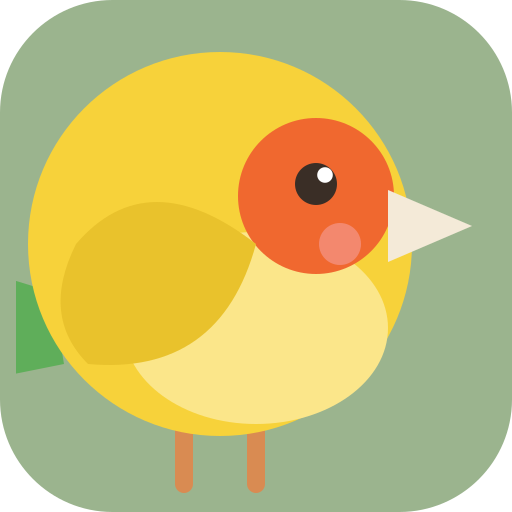

<p align="center">
  
</p>

# Mango's Garden

**Play it live: <https://mangosgarden.lovable.app/>**

A tiny daily bird-feeding game for phones. Once a day the player puts out one of four snacks. A wild bird visits, Mango the parrot reacts, and the bird goes into the **Bird book**. After that the garden is closed until local midnight. Come back every day to grow a streak and fill the book with all 12 birds.

Rarity tuning (see `npm run simulate`):

| Value | Default |
|---|---|
| Rarity weights | common 10, uncommon 6, rare 0.5 |
| Pity boost | uncollected rare birds only: x(1 + 0.05 per day since the last new rare bird), capped at x3, reset only when a new rare bird is discovered; off once both rares are collected |

More detail: [docs/how-it-works.md](docs/how-it-works.md) · [docs/storage.md](docs/storage.md) · [docs/configuration.md](docs/configuration.md) · [docs/extending.md](docs/extending.md)

## Project structure

```text
src/
  data/                 Game content. Edit these to tune the game.
    birds.ts            The 12 birds, rarity weights, food affinity values and how each bird looks
    foods.ts            The 10 foods (id, name, emoji fallback)
    mango-lines.ts      Everything Mango says: greetings, moods, visit reactions, milestones
  i18n/                 Languages: en.ts and mk.ts (every UI string), languages.ts (the
                        registry plus t()/localized()/initialLanguage()), LanguageProvider.tsx
  lib/                  Pure logic plus storage. No React in here.
    game.ts             Daily food offer, date keys, streak math, midnight countdown
    visitor.ts          Visitor scoring and the seeded weighted pick
    personality.ts      Which reaction group to use, non-repeating variants, milestones, food-hint threshold
    random.ts           Seeded random number generator and shuffle (deterministic)
    storage.ts          Every localStorage read/write, with safe fallbacks
    sounds.ts           Web Audio chirp, squawk and pat chirp (no audio files)
    pat.ts              Once-a-day "Pet Mango" claim, on its own storage key
    bird-links.ts       "Find out more" / "Ask ChatGPT" URLs for a bird, in the chosen language
    *.test.ts           Unit tests next to the code they cover
  components/
    FoodIcon.tsx        One flat SVG per food id (the FOOD_ICONS registry)
    layout/PageShell.tsx  Shared frame: streak pill + floating book/sound/language controls
    garden/             UI pieces
      BirdSvg.tsx       Draws any bird from its data "look" fields
      Mango.tsx         Mango the parrot
      GardenScene.tsx   Garden background, feeder, Mango and speech bubble
      GardenDecor.tsx   Wildflowers, fig branch, apple tree, butterflies (behind all UI)
      FoodPicker.tsx    The 4 food buttons
      BirdCard.tsx      The card shown after a visit
      SpeechBubble.tsx  Mango's speech bubble
      RarityBadge.tsx   Rarity gem with a translated tooltip
      MeetMango.tsx     Welcome dialog: Mango's photo, story, how to play, credit
      PatMango.tsx      Once-a-day "Pet Mango" button, hearts and bounce
    ui/                 shadcn primitives (dialog, button, popover, tooltip)
  debug/                Hidden developer test panel (see below)
  routes/
    index.tsx           The game: welcome → garden → pantry dialog → landing → bird card
    book.tsx            The Bird book page
    __root.tsx          Page shell and metadata
public/
  favicon.svg, apple-touch-icon.png, icon-192.png, icon-512.png, manifest.webmanifest
```

## Birds and foods

The book contains **12 birds: 9 common, 1 uncommon, 2 rare**. Unlisted food affinities remain **0.2**; loved foods score **3** and liked foods **1**.

| Bird ID | English / Macedonian | Rarity | Loves | Likes |
|---|---|---|---|---|
| robin | European Robin / Црвеногушка | common | mealworms | berries, water, apple |
| bluetit | Blue Tit / Сина сипка | common | peanuts, sunflower | mealworms |
| greattit | Great Tit / Голема сипка | common | sunflower | peanuts, walnut |
| blackbird | Blackbird / Кос | common | apple, mealworms | berries, water |
| goldfinch | Goldfinch / Штиглец | common | sunflower | millet |
| sparrow | House Sparrow / Домашно врапче | common | millet, water | wheat, sunflower |
| dove | Collared Dove / Гугутка | common | wheat, millet | sunflower, water |
| magpie | Magpie / Страчка | common | walnut | peanuts, mealworms |
| jackdaw | Jackdaw / Чавка | common | wheat | walnut, apple |
| woodpecker | Great Spotted Woodpecker / Голем клукајдрвец | uncommon | walnut, peanuts | sunflower, mealworms |
| hoopoe | Hoopoe / Пупунец | rare | mealworms, water | apple |
| waxwing | Waxwing / Свилокрилка | rare | berries, apple, orange | — |

| Food ID | English | Macedonian | Fallback emoji |
|---|---|---|---|
| sunflower | Sunflower seeds | Сончогледови семки | 🌻 |
| millet | Millet | Просо | 🟡 |
| peanuts | Peanuts | Кикирики | 🥜 |
| wheat | Wheat | Пченица | 🌾 |
| apple | Apple slices | Парчиња јаболко | 🍎 |
| berries | Mixed berries | Мешани бобинки | 🫐 |
| orange | Orange half | Половина портокал | 🍊 |
| mealworms | Mealworms | Брашнени црви | 🐛 |
| walnut | Walnuts | Ореви | 🌰 |
| water | Fresh water bath | Капење во свежа вода | 💧 |

**Artwork:** every food is drawn by `src/components/FoodIcon.tsx` (one flat SVG per id, using the theme tokens). The emoji column is only the fallback used when a food has no artwork.

Retained birds and foods keep their IDs. Retired bird IDs are ignored in the book and totals; retired foods are dropped from recorded discoveries and invalid daily offers are regenerated. A saved visit with a retired food is discarded from daily history so it cannot leave an invisible feeding lock. Other saved progress, weights, and pity rules remain unchanged.

### Simulation with this content

`npm run simulate` runs 5,000 seeded players for 365 days, choosing randomly among each day's four foods with the unchanged weights and pity rule.

| Metric | Result |
|---|---|
| Median days to complete the book | 45 |
| 90th-percentile days to complete | 91 |
| Median days to first rare bird | 16 |
| Common / uncommon / rare visit share | 90.0% / 7.4% / 2.7% |
| Players unfinished after a year | 0 of 5,000 |

Visit percentages are rounded independently.

## What's on screen

- **Welcome:** the title, **Start**, and a **Meet Mango** dialog with Mango's photo, the story behind the game, a 3-step "How to play", a note that nothing is tracked, and Daniela's credit.
- **Garden:** the scene fills the whole visible screen, with wildflowers, a fig branch, a distant apple tree and drifting butterflies behind everything. **Put out a snack** opens the *Today's pantry* dialog with the 4 foods; **Pet Mango** is a once-a-day pat that bounces Mango, floats hearts and chirps, then hides itself until tomorrow.
- **Bird card:** the visitor, its rarity gem, fun fact, "Find out more" / "Ask ChatGPT" links, Mango's reaction, any milestone ribbon, and the next-visit countdown.
- **Bird book:** "X of 12 collected" with a progress bar, total visits and best streak. Collected birds show a rarity gem and open a dialog (bird in a rarity-coloured ring, fact, first seen, visit count, "Seen eating" and "Favorite foods" as food chips, plus the two learning links). Locked birds sit behind a soft blur, are not tappable and have no links. Favorite foods unlock after 3 visits; until then the dialog shows a lock, "Visit N more times to discover" and an `n/3` counter.
- **Always available:** the streak pill, and the floating book / sound / language controls (all 44px, with hover or tap tooltips).

## Languages

English (`en`) and Macedonian (`mk`) are available from the round EN/МК control. The separate `mangos-garden:language` preference defaults to the device language when supported, otherwise English. It never changes game saves, stable bird/food IDs, scoring, or stored reaction strings. Existing English reactions are translated at display time, including after reload. Missing data translations fall back to English. Dates and numbers use the selected locale; Nunito supplies Cyrillic glyphs where Fredoka has none. Language detection happens after hydration, so server-rendered metadata starts in English and updates with the selected language in the browser.

To add another language:
1. Create `src/i18n/<code>.ts` with the same keys as `en.ts` (use `Record<keyof typeof en, string>`).
2. Import it and add one entry (id, label, locale, messages) to `languages` in `src/i18n/languages.ts`. The control cycles through this list automatically.
3. Add that language to every `BIRD_TEXT`, `FOOD_TEXT`, and `MANGO_TEXT` entry in the existing data files. Keep English text and IDs unchanged.
4. Run `npm test`; the translation coverage tests use the registry to check every language. Check long text at 360px.

## Run it

```sh
npm install        # or: bun install
npm run dev        # starts the app at http://localhost:8080
npm test           # runs all unit tests once (Vitest)
npm run test:watch # re-runs tests when files change
npm run simulate   # 5,000 seeded players x 365 days, to check rarity tuning
```

## Dates and saved data

- **Today:** every "today" (food seed, bird seed, daily lock, streak, countdown, freshness) comes from `todayKey()` in `src/lib/game.ts`: the device's local calendar date as `YYYY-MM-DD`, never UTC. Yesterday/two days ago use `daysBefore()`, which steps calendar days, so daylight-saving changes cannot break streaks or freshness. A last visit dated in the future (clock moved back) keeps the streak instead of resetting it.
- **Saved-data version:** `mangos-garden:version` (currently `1`). `migrate()` in `src/lib/storage.ts` runs on load and upgrades old saves step by step (v0 → v1 turns any saved bird/food names into stable ids); it never wipes progress. When you change the saved shape, bump `STORAGE_VERSION` and add a step.
- **Robustness:** all localStorage access is wrapped; blocked, full or corrupted storage falls back to safe defaults and unknown birds/foods are dropped.
- **Tests:** run in the fixed time zone `Europe/Skopje` (set in `vitest.config.ts`); see `src/lib/dates.test.ts`.

## Testing date-based features by hand

Days are local `YYYY-MM-DD` strings. Open the browser dev tools → Application → Local Storage:

- **Pretend today never happened:** open `/?debug=1`, scroll below the game, expand **Developer test panel**, and press **Reset today**.
- **Simulate "yesterday's visit":** in `mangos-garden:days`, rename today's key (for example `2026-11-11`) to yesterday's date, then reload. Food choice unlocks and the yesterday rules apply (fresh foods, freshness penalty, "yesterday" reaction).
- **Test streaks:** edit `mangos-garden:streak`, for example `{"current":2,"best":2,"lastVisit":"<yesterday>"}`, then feed today to reach the 3-day milestone.
- **Test food hints:** set a bird's `visits` to `2` in `mangos-garden:collection`; the next visit reveals its favorite foods.
- **Test Pet Mango:** the button hides after one pat. **Reset today** in the developer panel clears it, or delete `mangos-garden:pat`.
- **Start fresh:** delete all `mangos-garden:*` keys. Milestones only show once, so clear `mangos-garden:personality` to see them again.

## Known limitations

- Days use the device clock and time zone. Changing the clock or travelling can skip or repeat a day.
- Everything is saved in this browser only: no accounts, no cross-device sync. Clearing site data erases progress.
- The daily offer and visitor are seeded by date, so two players picking the same food on the same day (with the same history) get the same bird.
- Sounds need a tap first (browser rule) and are silent on devices without Web Audio.
- No `sitemap.xml` yet: it has to list the game's real web address, so add it after publishing and reference it from `robots.txt`.

## Hidden developer test panel

Open `/?debug=1` (or `/book?debug=1`). This enables the collapsible drawer below the game for this browser tab's session, including navigation and reloads. Normal visits do not show it. The drawer is in page flow, not over the scene: scroll down to use it.

- **Clock:** +1 day, +2 days, -1 day step local calendar days (including daylight-saving changes). **Jump to 23:59** sets the shifted day's local time to 23:59:00; let the countdown run to midnight. **Back to real time** removes the offset. A banner in the drawer identifies the fake time while shifted.
- **Readout:** clock, today's actual offer, yesterday's saved offer, streak/best, pity counter, chosen bird/food, and daily lock. Missing previous offers are shown as unrecorded, not invented.
- **Setup:** set streak (anchored to yesterday unless already fed today), pity, or a chosen bird's visit count. Zero visits removes that bird. Existing food discoveries and first-seen dates remain when changing a collected bird's count. **Clear all game data** asks for confirmation, then clears progress, milestones and sound; unrelated browser data and the debug clock/session are kept.
- **Reset today:** calls the existing `resetDay` in `src/lib/storage.ts` unchanged, restoring the collection snapshot, streak/best, previous history and pity. Milestone/reaction memory still does not reset.
- Actions reload the current screen to use the normal saved-data loading path. Setup tools intentionally edit this browser's real game progress; use a separate browser profile for disposable tests.

The shared `getNow()` clock in `src/lib/game.ts` returns real time plus the separately stored `mangos-garden-debug:clock-offset` millisecond offset. `todayKey()` and the default `msUntilMidnight()` use it; calendar constructors for formatting saved dates and day arithmetic are not reads of the real clock. `mangos-garden-debug:enabled` is sessionStorage only. All debug storage access tolerates blocked or invalid storage. With no offset, gameplay is unchanged.

### Disable or completely remove

Set **`ENABLE_DEBUG_PANEL = false`** in `src/lib/game.ts` to disable the drawer, ignore `?debug=1`, and ignore any saved offset. No game progress is deleted.

To remove completely, delete exactly:

1. `src/debug/actions.ts`, `src/debug/DeveloperPanel.tsx`, `src/debug/DeveloperPanel.test.tsx`, and `src/debug/disabled.test.tsx` (the whole `src/debug/` directory).
2. In `src/routes/__root.tsx`, the import line ending `// Removable debug import` and the mount line containing `{/* Removable debug mount */}`.
3. In `src/lib/game.ts`, the block from `// BEGIN removable developer clock` through `// END removable developer clock`; replace it with `export function getNow(): Date { return new Date(); }`. Keep `todayKey(now = getNow())` and `msUntilMidnight(now = getNow())` so all gameplay still shares one clock.
4. In `AGENTS.md`, the rule beginning `Gameplay reads current time` and this README's **Hidden developer test panel** section; replace the reset-testing bullet above with your preferred testing procedure.

No changes to storage or game algorithms need undoing. The old normal-screen reset link was removed as requested; the reset operation remains in `src/lib/storage.ts`.
